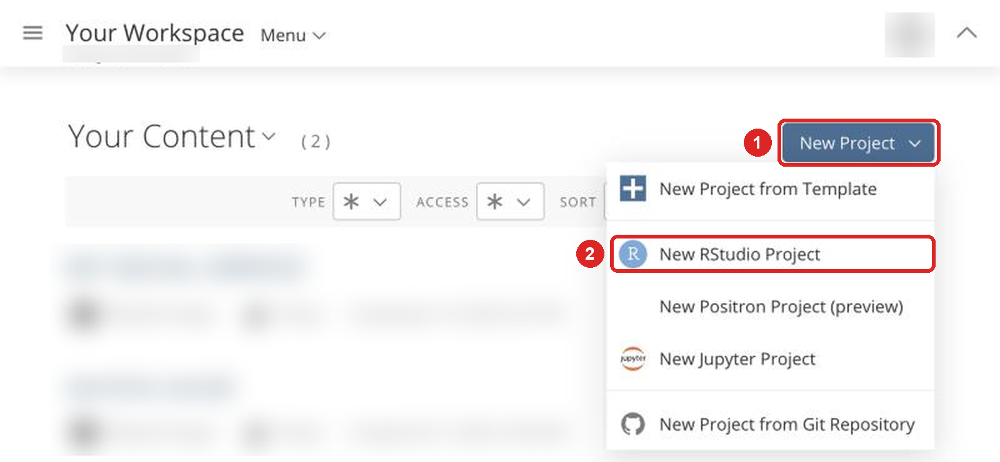
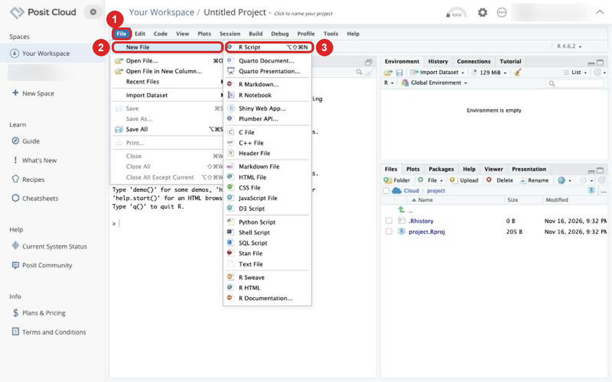
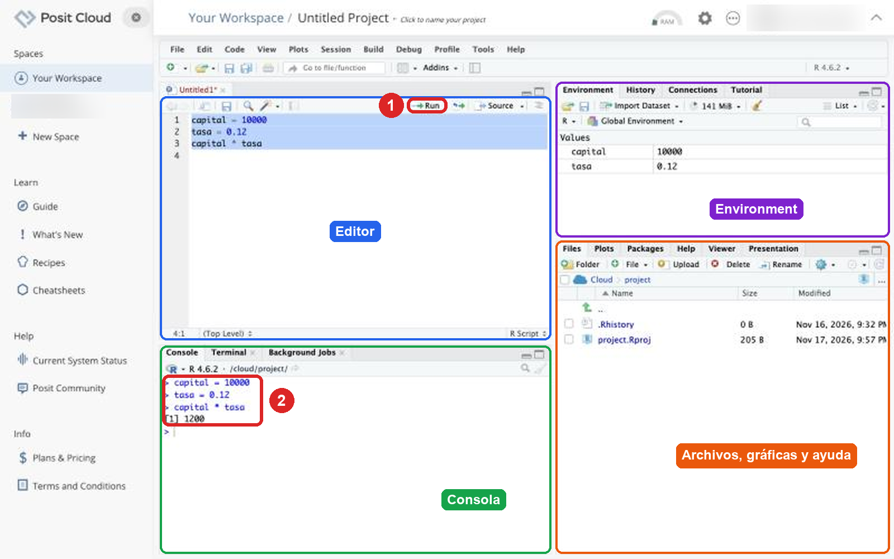
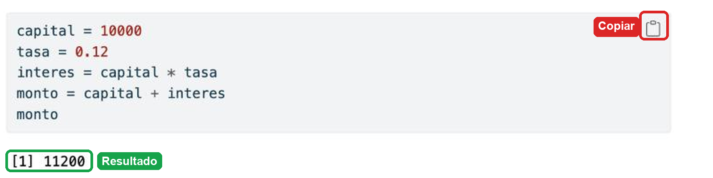

En esta primera lección conocerás qué es R y por qué lo utilizaremos a lo largo
del curso, así como RStudio y Posit Cloud, los entornos desde los cuales podrás
escribir y ejecutar tu código. Posteriormente, revisaremos los objetos básicos
del lenguaje, es decir, los vectores, las matrices, las listas y los *data
frames*, que serán la base para realizar los cálculos financieros de las
siguientes lecciones.

## ¿Qué es R?

R es un lenguaje de programación diseñado para el análisis estadístico y la visualización de datos. Fue creado a principios de
la década de 1990 por Ross Ihaka y Robert Gentleman en la Universidad de
Auckland, y hoy es una herramienta de uso común en la investigación, la
industria y las finanzas.

Una de sus principales características es que se trata de software libre y
gratuito, por lo que cualquier persona puede instalarlo en su computadora sin
costo alguno. Además, cuenta con una amplia comunidad de usuarios que desarrolla
y comparte librerías, herramientas que puedes instalar para resolver problemas
particulares sin necesidad de programarlos desde cero. Actualmente existen más de
20 000 librerías disponibles en CRAN, el repositorio oficial de R, entre las que
se encuentran, por ejemplo, `ggplot2`, para la elaboración de gráficas; `dplyr`, para la
manipulación de datos; `quantmod`, para descargar y analizar información de los
mercados financieros, o bien, `FinancialMath`, que utilizaremos a lo largo de
este curso para realizar cálculos financieros.

## RStudio y Posit Cloud

**RStudio** es un entorno de desarrollo integrado (IDE) para trabajar con R,
desarrollado por la empresa **Posit**. RStudio funciona como un puente entre
nosotros y R, ya que nos permite comunicarnos con el lenguaje a través de una
sola ventana que reúne un editor para escribir código, una consola para
ejecutarlo y paneles para consultar resultados, gráficos y archivos.

Posit ofrece además **Posit Cloud**, una versión de RStudio que funciona
directamente en el navegador. Permite programar en R sin instalar nada en la
computadora y sin depender de su capacidad de procesamiento, por lo que es una
buena opción para comenzar.

### ¿Cómo utilizar Posit Cloud?

Para comenzar, ingresa a [posit.cloud](https://posit.cloud) y crea una cuenta
gratuita desde la opción *Sign Up*; también puedes registrarte con tu cuenta de
Google o de GitHub. Una vez dentro, encontrarás tu espacio de trabajo
(*Your Workspace*), donde se guardarán todos tus proyectos. Para crear uno
nuevo, da clic en el botón **New Project** y selecciona
**New RStudio Project**. Después de unos segundos, se abrirá RStudio
directamente en tu navegador.



Dentro del proyecto, el siguiente paso es crear un script, es decir, un archivo
en el que escribirás tu código para poder guardarlo, modificarlo y volver a
ejecutarlo cuando lo necesites. Para ello, ve al menú **File**, selecciona
**New File** y después **R Script**.



Una vez creado el script, la ventana de RStudio quedará dividida en cuatro
paneles. En la parte superior izquierda se encuentra el editor, donde escribirás
tu código; debajo de él, la consola, que muestra los resultados al ejecutarlo.
Del lado derecho, en la parte superior, el panel *Environment* muestra los
objetos que has creado, mientras que en la parte inferior podrás consultar tus
archivos, gráficas y la ayuda de R.

Para ejecutar el código, selecciona las líneas que deseas correr y da clic en el
botón **Run**, o bien, presiona `Ctrl + Enter` (`Cmd + Enter` en Mac). En el
siguiente ejemplo, se guardan un capital y una tasa de interés, y se calcula el
interés correspondiente; observa cómo el resultado aparece en la consola y los
objetos en el panel *Environment*.



Con esto tendrás todo lo necesario para reproducir los ejemplos de este curso:
basta con copiar el código de cada lección, pegarlo en tu script y ejecutarlo.

### Tu primer ejemplo

Para que pongas en práctica lo anterior, a continuación encontrarás tu primer
bloque de código. Pasa el cursor sobre el recuadro gris y da clic en el ícono de
copiar que aparece en la esquina superior derecha; posteriormente, pégalo en tu
script de Posit Cloud, selecciona todas las líneas y ejecútalas con el botón
**Run**.



```{r}
capital = 10000
tasa = 0.12
interes = capital * tasa
monto = capital + interes
monto
```

Si todo salió bien, en tu consola deberá aparecer el mismo resultado que se
muestra debajo del recuadro, es decir, el monto que se obtiene al invertir
10 000 pesos durante un año a una tasa del 12 %. Te invitamos a cambiar el valor
del capital o de la tasa y volver a ejecutar el código para observar cómo
cambia el resultado.

## Objetos en R

En R, todo aquello con lo que trabajamos recibe el nombre de **objeto**. Un
objeto puede ser un número, como el monto de un préstamo; un texto, como el
nombre de un cliente; un valor lógico, que indica si una condición es verdadera
o falsa, o bien, el resultado de un cálculo, como el interés que genera una
inversión. Para guardar un objeto, basta con asignarle un nombre a través del
signo `=`.

```{r}
# Un número
capital = 10000

# Un texto, que siempre se escribe entre comillas
cliente = "Ana Torres"

# Un valor lógico: TRUE (verdadero) o FALSE (falso)
credito_aprobado = TRUE

# El resultado de un cálculo
tasa = 0.12
interes = capital * tasa
```

Una vez creados, podemos consultar el contenido de cualquier objeto con solo
escribir su nombre:

```{r}
cliente
credito_aprobado
interes
```

A partir de ese momento, podemos utilizar el nombre del objeto en lugar de su
valor, lo que nos permite reutilizarlo en cálculos posteriores sin necesidad de
escribirlo de nuevo. Por ejemplo, para conocer el monto que se tendrá al final
del año, basta con sumar el capital y el interés:

```{r}
capital + interes
```

Para asignar un nombre a un objeto también puedes utilizar el operador `<-`,
ya que cumple exactamente la misma función que el signo `=`. Por ejemplo,
`capital = 10000` y `capital <- 10000` producen el mismo resultado.

R nos ofrece algunas funciones que nos permiten conocer mejor nuestros objetos, es decir, saber qué tipo de dato contienen y cómo
está organizada la información que guardan. Las más utilizadas son:

- `class()`, que nos indica el tipo de un objeto.
- Las funciones de la familia `is`, como `is.numeric()`, que nos permiten
  confirmar si un objeto es de un tipo en particular.
- `str()`, que nos muestra de manera resumida el tipo y el contenido de un
  objeto.

La función `class()` nos indica el tipo de un objeto. Por ejemplo, nos dice si
se trata de un número (`numeric`), de un texto (`character`) o de un valor
lógico (`logical`):

```{r}
class(capital)
class(cliente)
class(credito_aprobado)
```

Estos no son los únicos tipos que existen. R cuenta con muchos otros, como las
fechas (`Date`) o los números enteros (`integer`), y además cada librería puede
definir sus propios tipos de objetos, de acuerdo con la información que
necesite manejar. A lo largo del curso nos encontraremos con algunos de ellos.

Por otro lado, si lo que queremos es confirmar si un objeto es de un tipo en
particular, podemos utilizar las funciones `is.numeric()`, `is.character()` o
`is.logical()`, las cuales responden con `TRUE` si el objeto es del tipo
indicado y con `FALSE` en caso contrario:

```{r}
is.numeric(capital)
is.character(capital)
```

Finalmente, la función `str()` nos muestra en una sola línea el tipo de dato y
el contenido de un objeto:

```{r}
str(capital)
str(cliente)
str(credito_aprobado)
```

Los objetos de R no se limitan a guardar un solo valor, sino que también pueden
reunir varios y organizarlos en una o más dimensiones, como un conjunto de
números o una tabla de datos. En las siguientes secciones revisaremos los
cuatro tipos más importantes: los vectores, las matrices, las listas y los
*data frames*.

### Vectores

Un **vector** es un conjunto de elementos del mismo tipo: números, textos o
valores lógicos (`TRUE` o `FALSE`). Se crea con la función `c()`, que combina
los elementos que le indiquemos.

La letra `c` proviene de la palabra *concatenar*, que significa unir o
encadenar elementos uno detrás de otro. Así, al escribir
`c(1500, 1500, 2000, 2500)`, le indicamos a R que una esos cuatro valores en un
solo objeto, respetando el orden en que los escribimos.

```{r}
pagos = c(1500, 1500, 2000, 2500)
meses = c("Enero", "Febrero", "Marzo", "Abril")

pagos
meses
```

La función `c()` también nos permite concatenar vectores que ya existen. Por
ejemplo, podemos unir los meses de dos trimestres en un solo vector:

```{r}
trimestre_1 = c("Enero", "Febrero", "Marzo")
trimestre_2 = c("Abril", "Mayo", "Junio")
c(trimestre_1, trimestre_2)
```

#### Estructura de un vector

Cada uno de los elementos de un vector ocupa una posición, la cual se asigna de
acuerdo con el orden en que los escribimos al crearlo. En el caso de nuestro
vector `pagos`, su estructura es la siguiente:

| Posición | 1    | 2    | 3    | 4    |
|----------|------|------|------|------|
| `pagos`  | 1500 | 1500 | 2000 | 2500 |

El número total de elementos que contiene un vector se conoce como su
**tamaño** o **longitud**, y podemos conocerlo a través de la función
`length()`:

```{r}
length(pagos)
```

En este caso, el vector `pagos` tiene un tamaño de 4, ya que reúne cuatro
elementos.

#### ¿Cómo consultar los elementos de un vector?

Las posiciones de un vector nos permiten consultar cada uno de sus elementos.
Para ello, escribimos el nombre del vector seguido de corchetes `[ ]` con la
posición del elemento que nos interesa. Es importante tener en cuenta que, en
R, las posiciones se cuentan a partir del 1, de manera que el primer elemento
ocupa la posición 1, el segundo la posición 2, y así sucesivamente. Esto es
distinto de otros lenguajes de programación, como Python, en los que se
comienza a contar desde el 0.

```{r}
meses[1]
pagos[3]
```

También podemos consultar varios elementos a la vez:

- **Elementos específicos**, indicando sus posiciones con la función `c()`:

  ```{r}
  meses[c(1, 3)]
  ```

- **Un rango de elementos**, indicando la primera y la última posición
  separadas por dos puntos:

  ```{r}
  meses[2:4]
  ```

- **Todos los elementos excepto uno**, anteponiendo un signo de menos a su
  posición:

  ```{r}
  meses[-1]
  ```

Finalmente, si intentamos consultar una posición que no existe, como
`meses[5]`, R no nos mostrará un error, sino el valor `NA`, que significa que
no hay ningún dato disponible en esa posición.

Es importante recordar que todos los elementos de un vector deben ser del mismo
tipo. Si intentamos combinar elementos de distintos tipos, R no nos mostrará
ningún error, sino que convertirá todos los elementos al tipo que sea capaz de
representarlos a todos:

```{r}
mezcla = c(1500, "Enero", TRUE)
mezcla
class(mezcla)
```

En este ejemplo, tanto el número `1500` como el valor lógico `TRUE` se
convirtieron en texto, como lo indican las comillas, ya que el texto es el único
tipo que puede representar a los tres elementos. Por ello, conviene verificar
siempre el tipo de nuestros vectores con `class()` o `str()`, sobre todo cuando
los resultados no son los que esperábamos.

#### Conocer el tipo y la estructura de un vector

Al igual que con cualquier otro objeto, podemos utilizar las funciones
`class()`, `is` y `str()` para conocer mejor nuestros vectores. La función
`class()` nos indica el tipo de sus elementos:

```{r}
class(pagos)
class(meses)
```

Las funciones de la familia `is` nos permiten confirmar si un vector es de un
tipo en particular:

```{r}
is.numeric(pagos)
is.character(pagos)
```

Por su parte, la función `str()` nos muestra en una sola línea el tipo de sus
elementos, cuántos son y cuáles son sus valores:

```{r}
str(pagos)
str(meses)
```

La expresión `[1:4]` corresponde a las posiciones de sus elementos, es decir,
nos indica que el vector tiene un tamaño de 4, con elementos numerados del 1
al 4.

#### Operaciones con vectores

Una de las grandes ventajas de los vectores es que nos permiten realizar una
misma operación sobre todos sus elementos a la vez, sin necesidad de
calcularlos uno por uno. Las operaciones más comunes son las siguientes.

**Operaciones con un número.** Cuando sumamos, restamos, multiplicamos o
dividimos un vector por un número, la operación se aplica a cada uno de sus
elementos. Por ejemplo, si cada pago aumentara un 10 % o se le agregaran 100
pesos:

```{r}
pagos * 1.10
pagos + 100
```

**Operaciones entre vectores.** Si operamos dos vectores del mismo tamaño, R
combina sus elementos de acuerdo con su posición, es decir, el primero con el
primero, el segundo con el segundo, y así sucesivamente. Por ejemplo, para
sumar a cada pago su comisión correspondiente:

```{r}
comisiones = c(30, 30, 40, 50)
pagos + comisiones
```

Es importante tener en cuenta que solo podemos realizar operaciones aritméticas
con vectores numéricos. Si intentamos, por ejemplo, sumar un vector de números
con uno de texto, R nos mostrará un error, ya que no es posible sumar un número
con una palabra:

```{r}
#| error: true
pagos + meses
```

En cambio, si operamos un vector numérico con uno de valores lógicos, R no
mostrará ningún error, ya que convierte `TRUE` en 1 y `FALSE` en 0 antes de
realizar la operación:

```{r}
pagos + c(TRUE, FALSE, TRUE, FALSE)
```

Algo similar ocurre si los vectores tienen distinto tamaño. En ese caso, R
repite los elementos del vector más corto hasta completar el tamaño del más
largo, lo que puede producir resultados inesperados. Por ello, conviene
verificar siempre con `length()` que nuestros vectores tengan el mismo tamaño
antes de operarlos.

**Funciones de resumen.** R cuenta con funciones que nos permiten obtener
información general de un vector:

- `sum()`, que calcula la suma de todos sus elementos.
- `mean()`, que calcula su promedio.
- `min()` y `max()`, que nos indican su valor mínimo y máximo.
- `cumsum()`, que calcula la suma acumulada, es decir, el total que se lleva
  hasta cada posición.

```{r}
sum(pagos)
mean(pagos)
min(pagos)
max(pagos)
cumsum(pagos)
```

**Comparaciones.** También podemos comparar cada elemento de un vector con un
valor. El resultado es un vector de valores lógicos que nos indica, para cada
posición, si la condición se cumple:

```{r}
pagos > 1800
```

Esta comparación puede utilizarse dentro de los corchetes para consultar
únicamente los elementos que cumplen la condición:

```{r}
pagos[pagos > 1800]
```

Hasta ahora hemos trabajado con vectores, en los que los elementos se organizan
uno detrás de otro, es decir, en una sola dimensión. Sin embargo, en muchas
ocasiones resulta más conveniente organizar la información en filas y columnas,
como en una tabla. Para ello, R nos ofrece las matrices, que revisaremos a
continuación.

### Matrices

Una **matriz** es un objeto que organiza elementos en filas y columnas, es
decir, en dos dimensiones. Al igual que en los vectores, todos sus elementos
deben ser del mismo tipo; si combinamos elementos de distintos tipos, R los
convertirá al tipo que sea capaz de representarlos a todos. Se crea con la
función `matrix()`, a la que le indicamos los elementos que contendrá, así como
su número de filas (`nrow`) y de columnas (`ncol`).

Supongamos, por ejemplo, que queremos guardar los pagos que realizaron dos
clientes durante tres meses. Cada fila corresponderá a un cliente y cada
columna a un mes:

```{r}
pagos_clientes = matrix(
  c(1500, 2000, 1500, 2200, 1800, 2500),
  nrow = 2, ncol = 3
)
pagos_clientes
```

Observa que R acomoda los elementos columna por columna, es decir, primero
llena la primera columna, después la segunda, y así sucesivamente. Si
preferimos que los acomode fila por fila, basta con agregar el argumento
`byrow = TRUE`:

```{r}
matrix(
  c(1500, 1500, 1800, 2000, 2200, 2500),
  nrow = 2, ncol = 3, byrow = TRUE
)
```

Como puedes ver, ambas formas producen la misma matriz; lo único que cambia es
el orden en que escribimos los elementos.

Es importante notar que la función `matrix()` recibe sus elementos en forma de
vector. Por ello, cuando los escribimos uno por uno, deben ir dentro de la
función `c()`. Sin embargo, también podemos utilizar un vector que hayamos
creado previamente. Por ejemplo, a partir del vector `pagos` de la sección
anterior, podemos construir una matriz de 2 filas y 2 columnas:

```{r}
matrix(pagos, nrow = 2)
```

En este caso, basta con indicar el número de filas, ya que R calcula el número
de columnas a partir del total de elementos del vector.

#### Estructura de una matriz

A diferencia de los vectores, en los que cada elemento ocupa una sola
posición, en una matriz cada elemento se identifica por dos números: la fila y
la columna en la que se encuentra. En el caso de nuestra matriz
`pagos_clientes`, su estructura es la siguiente:

|            | Columna 1 | Columna 2 | Columna 3 |
|------------|-----------|-----------|-----------|
| **Fila 1** | 1500      | 1500      | 1800      |
| **Fila 2** | 2000      | 2200      | 2500      |

El tamaño de una matriz se expresa a través de sus **dimensiones**, es decir,
su número de filas y de columnas. Para conocerlas, R nos ofrece las siguientes
funciones:

- `dim()`, que nos indica el número de filas y de columnas, en ese orden.
- `nrow()`, que nos indica únicamente el número de filas.
- `ncol()`, que nos indica únicamente el número de columnas.

```{r}
dim(pagos_clientes)
nrow(pagos_clientes)
ncol(pagos_clientes)
```

En este caso, `pagos_clientes` es una matriz de 2 filas y 3 columnas, por lo
que reúne un total de seis elementos.

#### ¿Cómo consultar los elementos de una matriz?

Para consultar un elemento de una matriz, escribimos su nombre seguido de
corchetes con la forma `[fila, columna]`. Al igual que en los vectores, las
posiciones se cuentan a partir del 1:

```{r}
pagos_clientes[2, 3]
```

En este ejemplo, consultamos el elemento de la fila 2 y la columna 3, es decir,
el pago del segundo cliente en el tercer mes. También podemos consultar una
fila o una columna completa:

- **Una fila completa**, indicando su número y dejando vacía la posición de la
  columna:

  ```{r}
  pagos_clientes[1, ]
  ```

- **Una columna completa**, dejando vacía la posición de la fila e indicando el
  número de la columna:

  ```{r}
  pagos_clientes[, 2]
  ```

#### Conocer el tipo y la estructura de una matriz

Las funciones `class()`, `is` y `str()` también nos permiten conocer mejor
nuestras matrices. La función `class()` nos indica que se trata de una matriz:

```{r}
class(pagos_clientes)
```

R nos muestra dos palabras, `matrix` y `array`, ya que una matriz es un caso
particular de un *array*, que es un objeto que puede tener cualquier número de
dimensiones. Por su parte, la función `is.matrix()` nos permite confirmar si un
objeto es una matriz, mientras que `is.numeric()` nos indica si sus elementos
son números:

```{r}
is.matrix(pagos_clientes)
is.numeric(pagos_clientes)
```

Finalmente, la función `str()` nos muestra el tipo de sus elementos, sus
dimensiones y sus valores:

```{r}
str(pagos_clientes)
```

La expresión `[1:2, 1:3]` nos indica que la matriz tiene 2 filas y 3 columnas.

#### Nombres de filas y columnas

Para que una matriz sea más fácil de leer, podemos asignarle nombres a sus
filas y a sus columnas a través de las funciones `rownames()` y `colnames()`:

```{r}
rownames(pagos_clientes) = c("Cliente A", "Cliente B")
colnames(pagos_clientes) = c("Enero", "Febrero", "Marzo")
pagos_clientes
```

Una vez asignados, podemos utilizar estos nombres en lugar de las posiciones
para consultar sus elementos:

```{r}
pagos_clientes["Cliente A", "Marzo"]
```

#### Operaciones con matrices

Al igual que con los vectores, podemos realizar una misma operación sobre todos
los elementos de una matriz a la vez. Las operaciones más comunes son las
siguientes.

**Operaciones con un número.** La operación se aplica a cada uno de sus
elementos. Por ejemplo, si cada pago aumentara un 10 %:

```{r}
pagos_clientes * 1.10
```

**Operaciones entre matrices.** Si operamos dos matrices con las mismas
dimensiones, R combina sus elementos de acuerdo con su posición. Por ejemplo,
para sumar a cada pago su comisión correspondiente:

```{r}
comisiones = matrix(
  c(30, 40, 30, 45, 35, 50),
  nrow = 2, ncol = 3
)
pagos_clientes + comisiones
```

Si las matrices no tienen las mismas dimensiones, R nos mostrará un error, ya
que no es posible combinar sus elementos uno a uno.

**Funciones de resumen.** Además de las funciones que ya conocemos, como
`sum()` o `mean()`, R cuenta con funciones que nos permiten resumir una matriz
por filas o por columnas:

- `rowSums()`, que calcula la suma de cada fila.
- `colSums()`, que calcula la suma de cada columna.

```{r}
sum(pagos_clientes)
rowSums(pagos_clientes)
colSums(pagos_clientes)
```

En nuestro ejemplo, `rowSums()` nos indica el total que pagó cada cliente,
mientras que `colSums()` nos indica el total que se recibió en cada mes.

**Transposición.** La función `t()` intercambia las filas por las columnas, de
manera que los meses pasan a ser filas y los clientes, columnas:

```{r}
t(pagos_clientes)
```

**Multiplicación matricial.** El operador `%*%` realiza el producto de matrices
que se estudia en álgebra lineal, en el que cada fila de la primera matriz se
multiplica por cada columna de la segunda y los resultados se suman. Para que
esta operación sea posible, el número de columnas de la primera matriz debe ser
igual al número de filas de la segunda. Por ejemplo, al multiplicar nuestra
matriz por un vector de tres unos, obtenemos el total que pagó cada cliente:

```{r}
pagos_clientes %*% c(1, 1, 1)
```

Las matrices nos permiten organizar la información en filas y columnas, pero
con una limitación importante: todos sus elementos deben ser del mismo tipo. En
la siguiente sección revisaremos las listas, un tipo de objeto que nos permite
reunir elementos de distintos tipos en un mismo lugar.

### Listas

Una **lista** es un objeto que, a diferencia de los vectores y las matrices,
puede reunir elementos de distintos tipos y tamaños. En una misma lista podemos
guardar números, textos y valores lógicos, pero también vectores, matrices e
incluso otras listas. Se crea con la función `list()`, a la que le indicamos
los elementos que contendrá y, de manera opcional, un nombre para cada uno de
ellos.

Supongamos, por ejemplo, que queremos guardar la información de un crédito: el
nombre del cliente, el monto prestado, las tasas que se le ofrecieron y si el
crédito fue aprobado:

```{r}
credito = list(
  cliente = "Ana Torres",
  monto = 50000,
  tasas = c(0.12, 0.15),
  aprobado = TRUE
)

credito
```

Observa que cada elemento de la lista conserva su propio tipo: `cliente` es un
texto, `monto` es un número, `tasas` es un vector de dos elementos y
`aprobado` es un valor lógico.

#### Estructura de una lista

Al igual que en los vectores, cada elemento de una lista ocupa una posición,
que se asigna de acuerdo con el orden en que los escribimos. Además, si les
asignamos un nombre al crearla, cada elemento puede identificarse también por
ese nombre. En el caso de nuestra lista `credito`, su estructura es la
siguiente:

| Posición | Nombre     | Contenido      |
|----------|------------|----------------|
| 1        | `cliente`  | "Ana Torres"   |
| 2        | `monto`    | 50000          |
| 3        | `tasas`    | 0.12, 0.15     |
| 4        | `aprobado` | TRUE           |

Para conocer el tamaño de una lista, es decir, cuántos elementos contiene,
utilizamos la función `length()`, mientras que para conocer los nombres de sus
elementos utilizamos la función `names()`:

```{r}
length(credito)
names(credito)
```

Es importante notar que `length()` cuenta los elementos de la lista y no los
valores que hay dentro de cada uno. Aunque `tasas` contiene dos valores, para
la lista representa un solo elemento.

#### ¿Cómo consultar los elementos de una lista?

Para consultar un elemento de una lista, contamos con dos opciones:

- **El operador `$`**, seguido del nombre del elemento:

  ```{r}
  credito$monto
  ```

- **Los dobles corchetes `[[ ]]`**, con el nombre del elemento entre comillas
  o con su posición:

  ```{r}
  credito[["tasas"]]
  credito[[1]]
  ```

Ambas opciones nos devuelven el contenido del elemento, por lo que
`credito$monto` y `credito[["monto"]]` producen el mismo resultado. La
diferencia es que el operador `$` únicamente funciona con el nombre del
elemento, mientras que los dobles corchetes nos permiten utilizar también su
posición.

Es importante no confundir los dobles corchetes con los corchetes sencillos. Si
escribimos `credito["monto"]`, R no nos devolverá el número 50 000, sino una
nueva lista que contiene únicamente ese elemento:

```{r}
credito["monto"]
class(credito["monto"])
```

Por ello, si intentamos realizar una operación con este resultado, como
`credito["monto"] * 2`, R nos mostrará un error, ya que no es posible
multiplicar una lista por un número. Para trabajar con el contenido de un
elemento, debemos utilizar siempre el operador `$` o los dobles corchetes.

Una vez que consultamos un elemento, podemos trabajar con él como lo haríamos
con cualquier otro objeto. Por ejemplo, como `tasas` es un vector, podemos
consultar su segundo valor con los corchetes que ya conocemos:

```{r}
credito$tasas[2]
```

#### Conocer el tipo y la estructura de una lista

Las funciones `class()`, `is` y `str()` también nos permiten conocer mejor
nuestras listas. La función `class()` nos indica que se trata de una lista,
mientras que `is.list()` nos permite confirmarlo:

```{r}
class(credito)
is.list(credito)
```

En el caso de las listas, la función `str()` resulta especialmente útil, ya que
nos muestra en pocas líneas el nombre, el tipo y el contenido de cada uno de
sus elementos:

```{r}
str(credito)
```

La expresión `List of 4` nos indica que la lista tiene cuatro elementos, y cada
línea que comienza con `$` corresponde a uno de ellos.

#### Modificar una lista

A diferencia de los vectores y las matrices, las listas no admiten operaciones
aritméticas directamente, ya que sus elementos pueden ser de distintos tipos.
Sin embargo, sí podemos operar con cada uno de sus elementos por separado. Por
ejemplo, para calcular el monto con un incremento del 10 %:

```{r}
credito$monto * 1.10
```

También podemos modificar los elementos de una lista o agregar elementos
nuevos, asignándoles un valor a través del operador `$`:

- **Para modificar un elemento**, le asignamos un nuevo valor utilizando su
  nombre.
- **Para agregar un elemento**, le asignamos un valor utilizando un nombre que
  aún no exista en la lista.

```{r}
credito$monto = 60000
credito$plazo_meses = 24

str(credito)
```

Como puedes ver, el monto cambió a 60 000 y la lista ahora tiene un quinto
elemento, `plazo_meses`.

Las listas nos ofrecen una gran flexibilidad para reunir información de
distintos tipos. Sin embargo, cuando queremos guardar la misma información de
varios elementos a la vez, resulta más práctico organizarla en una tabla con
filas y columnas. Para ello, R nos ofrece los *data frames*, que revisaremos a
continuación.

### Data frames

Un ***data frame*** es un objeto que organiza la información en forma de tabla,
con filas y columnas, de manera muy similar a una hoja de cálculo. Se parece a
una matriz, pero con una diferencia importante: cada columna puede ser de un
tipo distinto. Así, en una misma tabla podemos tener una columna de textos,
otra de números y otra de valores lógicos.

Internamente, cada columna de un *data frame* es un vector, por lo que todos
los elementos de una misma columna deben ser del mismo tipo y todas las
columnas deben tener el mismo número de elementos. Se crea con la función
`data.frame()`, a la que le indicamos cada columna con su nombre y sus valores.

Supongamos, por ejemplo, que queremos guardar la información de tres clientes:
su nombre, su edad, su ingreso mensual y si cuentan con un crédito:

```{r}
clientes = data.frame(
  nombre = c("Carlos", "Pedro", "Erika"),
  edad = c(25, 30, 28),
  ingreso = c(18000, 25000, 22000),
  tiene_credito = c(TRUE, FALSE, TRUE)
)

clientes
```

Observa que R numera las filas de manera automática, del 1 al 3.

#### Estructura de un data frame

En un *data frame*, cada fila corresponde a un **registro**, en este caso, a
un cliente, mientras que cada columna corresponde a una **variable**, es decir,
a una característica que conocemos de todos los registros. Al igual
que en las matrices, su tamaño se expresa a través de sus dimensiones, por lo
que podemos utilizar las mismas funciones:

- `dim()`, que nos indica el número de filas y de columnas.
- `nrow()`, que nos indica el número de filas, es decir, de registros.
- `ncol()`, que nos indica el número de columnas, es decir, de variables.

```{r}
dim(clientes)
nrow(clientes)
ncol(clientes)
```

Para conocer el nombre de sus columnas, utilizamos la función `names()`:

```{r}
names(clientes)
```

#### ¿Cómo consultar los elementos de un data frame?

Como un *data frame* combina características de las listas y de las matrices,
podemos consultar sus elementos de ambas maneras:

- **Una columna completa**, con el operador `$` seguido de su nombre, tal como
  lo hacíamos con las listas:

  ```{r}
  clientes$ingreso
  ```

- **Un valor específico**, con corchetes de la forma `[fila, columna]`, tal
  como lo hacíamos con las matrices. La columna puede indicarse por su posición
  o por su nombre:

  ```{r}
  clientes[2, 3]
  clientes[2, "ingreso"]
  ```

- **Una fila completa**, indicando su número y dejando vacía la posición de la
  columna:

  ```{r}
  clientes[1, ]
  ```

Cuando consultamos una columna con el operador `$`, R nos devuelve un vector,
por lo que podemos aplicarle todas las operaciones y funciones que ya
conocemos. Por ejemplo, para calcular el ingreso promedio de los clientes:

```{r}
mean(clientes$ingreso)
```

Al igual que en las listas, es importante no confundir el operador `$` y los
dobles corchetes con los corchetes sencillos. Si escribimos
`clientes["ingreso"]`, R no nos devolverá un vector con los ingresos, sino un
nuevo *data frame* que contiene únicamente esa columna:

```{r}
clientes["ingreso"]
class(clientes["ingreso"])
```

Por ello, si intentamos calcular el promedio de este resultado con
`mean(clientes["ingreso"])`, R no podrá hacerlo y nos devolverá el valor `NA`.
Para trabajar con los valores de una columna, debemos utilizar siempre el
operador `$` o los dobles corchetes, como en `clientes[["ingreso"]]`.

#### Conocer el tipo y la estructura de un data frame

Las funciones `class()`, `is` y `str()` también nos permiten conocer mejor
nuestros *data frames*. La función `class()` nos indica que se trata de un
*data frame*, mientras que `is.data.frame()` nos permite confirmarlo:

```{r}
class(clientes)
is.data.frame(clientes)
```

Sin embargo, es con los *data frames* donde la función `str()` resulta más
útil, ya que en pocas líneas nos muestra el número de registros y de
variables, así como el nombre, el tipo y los primeros valores de cada columna:

```{r}
str(clientes)
```

La expresión `3 obs. of 4 variables` nos indica que la tabla tiene tres
registros (*obs.* es la abreviatura de *observations*, que es como R llama a
las filas) y cuatro variables, y cada línea que comienza con `$` corresponde
a una de sus columnas. Cuando trabajamos con tablas de cientos o miles de
filas, esta función nos permite revisar su contenido sin necesidad de
imprimirlas completas.

#### Modificar un data frame

Al igual que en las listas, podemos agregar columnas o modificar los valores de
un *data frame*:

- **Para agregar una columna**, le asignamos valores utilizando el operador `$`
  y un nombre que aún no exista. Estos valores pueden calcularse a partir de
  otras columnas; por ejemplo, el ingreso anual de cada cliente.
- **Para modificar un valor**, le asignamos un nuevo valor utilizando su
  posición de la forma `[fila, columna]`.

```{r}
clientes$ingreso_anual = clientes$ingreso * 12
clientes[1, "edad"] = 26

clientes
```

Finalmente, al igual que en los vectores, podemos utilizar comparaciones para
consultar únicamente las filas que cumplen una condición. Para ello, escribimos
la condición en la posición de las filas y dejamos vacía la de las columnas.
Por ejemplo, para consultar a los clientes mayores de 27 años:

```{r}
clientes[clientes$edad > 27, ]
```

## Resumen

En esta lección conocimos R, un lenguaje de programación gratuito que, gracias
a sus librerías, nos permite realizar desde cálculos sencillos hasta análisis
complejos, así como RStudio y Posit Cloud, las herramientas desde las cuales
escribiremos y ejecutaremos nuestro código. Además, revisamos los objetos, que
son la base de todo lo que haremos en R.

- **Objetos.** Todo aquello con lo que trabajamos en R es un objeto, y se crea
  asignándole un nombre con el signo `=` o con el operador `<-`. Para conocer
  mejor nuestros objetos, contamos con las funciones `class()`, las de la
  familia `is` y `str()`.
- **Vectores.** Reúnen elementos del mismo tipo en una sola dimensión. Se crean
  con la función `c()`, y sus elementos se consultan con corchetes, a partir de
  la posición 1.
- **Matrices.** Organizan elementos del mismo tipo en filas y columnas. Se
  crean con la función `matrix()`, y sus elementos se consultan con corchetes
  de la forma `[fila, columna]`.
- **Listas.** Reúnen elementos de distintos tipos y tamaños. Se crean con la
  función `list()`, y sus elementos se consultan con el operador `$` o con
  dobles corchetes `[[ ]]`.
- ***Data frames*.** Organizan la información en forma de tabla, en la que cada
  fila es un registro y cada columna una variable que puede ser de un tipo
  distinto. Se crean con la función `data.frame()`, y sus columnas se consultan
  con el operador `$`.

En la siguiente lección aprenderemos a darle instrucciones más elaboradas a R
a través de condicionales, ciclos y funciones.
