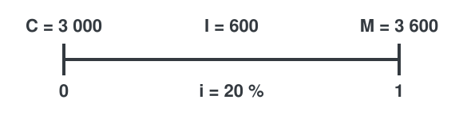

A lo largo de esta lección veremos qué es una tasa de interés y las distintas
formas en las que puede expresarse. Comenzaremos con los conceptos básicos, es
decir, el interés simple y el compuesto, así como las tasas efectivas,
nominales y de descuento. Luego, revisaremos la librería FinancialMath, que
utilizaremos durante el resto del curso, y su función `rate.conv()`, que nos
permite convertir una tasa en sus equivalentes. Por último, resolveremos dos
ejercicios en los que aplicaremos lo aprendido.

## Conceptos básicos

### El valor del dinero a través del tiempo

El dinero, como cualquier otro bien, posee un valor; sin embargo, a diferencia
de un pantalón o de un servicio, no podemos medirlo en términos de dinero. Si
tomamos como base su función principal, que es la de intercambio, **el valor
del dinero puede considerarse como la capacidad que tiene de ser intercambiado
por otros bienes**. Como los precios cambian conforme transcurre el tiempo, con
una misma cantidad de dinero no podemos comprar lo mismo hoy que dentro de dos
años.

Por ello, el dinero puede medirse de dos formas:

- **Valor nominal**, que es el número impreso en el billete o la moneda, y que
  no cambia con el tiempo.
- **Valor real**, que es el número de bienes que pueden comprarse con una
  cantidad determinada.

::: {.callout-note icon=false}
## Ejemplo

El año pasado una persona tenía 1 200 pesos y un pantalón costaba 300 pesos,
por lo que podía comprar 4 pantalones. Hoy, ese mismo pantalón cuesta 400 pesos
y la persona conserva sus 1 200 pesos: en términos nominales tiene lo mismo,
pero ahora solo puede comprar 3 pantalones, es decir, el valor real de su
dinero disminuyó.
:::

Al aumento generalizado en los precios de los bienes de una economía se le
conoce como **inflación**, y es la razón por la que el dinero pierde valor real
con el tiempo. Por ello, es preferible tener 500 pesos en este momento que
dentro de dos años.

### Intereses y tasa de interés

Los **intereses** son la cantidad de dinero que está dispuesta a pagar la
persona que pide un préstamo por hacer uso del dinero de otra. Por su parte, la
**tasa de interés** es el porcentaje que se paga por cada peso invertido o
prestado en un periodo determinado; por ejemplo, una tasa del 30 % anual
significa que, por cada peso invertido, al año se recibirán 0.30 pesos de
intereses.

::: {.callout-note icon=false}
## Ejemplo

Se invierten 3 000 pesos a una tasa de interés del 20 % anual. Al cabo de un
año, los intereses generados son $(3\,000)(0.20) = 600$, por lo que se retiran
$3\,000 + 600 = 3\,600$ pesos.
:::

A partir de este ejemplo, utilizaremos la siguiente notación:

- $C$, el **capital**, es decir, la cantidad invertida ($C = 3\,000$).
- $I$, los **intereses** generados ($I = 600$).
- $M$, el **monto**, es decir, la cantidad que se recibe al final
  ($M = 3\,600$).
- $i$, la **tasa de interés** ($i = 0.20$).

Estas cantidades pueden representarse en un **diagrama de tiempo**, que
consiste en una línea horizontal que representa el plazo de la operación, en
la que el capital se coloca al inicio y el monto al final:

{fig-alt="Diagrama de tiempo: un capital de 3 000 pesos en el periodo 0 se convierte en un monto de 3 600 pesos en el periodo 1, con una tasa del 20 % e intereses de 600 pesos." width="80%" fig-align="center"}

De manera general, en un periodo se tiene que:

$$
I = C\,i
\qquad \text{y} \qquad
M = C + I
$$

Sustituyendo la primera ecuación en la segunda, obtenemos una fórmula para
calcular directamente el monto:

$$
M = C + C\,i = C\,(1 + i)
$$

### Interés simple y compuesto

Cuando una inversión dura más de un periodo, los intereses pueden calcularse
de dos formas:

- En el **interés simple**, los intereses de cada periodo se calculan siempre
  sobre el capital inicial, por lo que son los mismos en cada periodo.
- En el **interés compuesto**, los intereses de cada periodo se suman al
  capital y, a su vez, generan nuevos intereses.

Así, después de $t$ periodos, el monto con interés simple es:

$$
M = C\,(1 + i\,t)
$$

mientras que, con interés compuesto, es:

$$
M = C\,(1 + i)^t
$$

::: {.callout-note icon=false}
## Ejemplo

Retomando el ejemplo anterior, si los 3 000 pesos se dejan invertidos durante
3 años al 20 % anual, con interés simple tendríamos:

$$
M = 3\,000\,(1 + 0.20 \times 3) = 4\,800
$$

mientras que, con interés compuesto, tendríamos:

$$
M = 3\,000\,(1 + 0.20)^3 = 5\,184
$$

Año con año, el monto crece de la siguiente forma:

| Año | Interés simple | Interés compuesto |
|-----|----------------|-------------------|
| 1   | 3 600          | 3 600             |
| 2   | 4 200          | 4 320             |
| 3   | 4 800          | 5 184             |

La diferencia de 384 pesos corresponde a los intereses que generaron los
intereses de los años anteriores.
:::

En el resto del curso trabajaremos con interés compuesto, que es el que se
utiliza en la mayoría de las operaciones financieras.

### Tasa efectiva y tasa nominal

Hasta ahora, hemos supuesto que los intereses se calculan una sola vez por
periodo. A una tasa de este tipo se le conoce como **tasa efectiva**; por
ejemplo, una tasa del 20 % efectiva anual significa que, al final de cada año,
se pagan intereses equivalentes al 20 % del saldo.

Sin embargo, en la práctica, es común que las tasas se anuncien como anuales,
aunque los intereses se calculen, es decir, se **capitalicen**, varias veces al
año. A una tasa de este tipo se le conoce como **tasa nominal**, y se denota
por $i^{(m)}$, donde $m$ es el número de veces que se capitaliza en un año. Por
ejemplo, una tasa del 12 % nominal capitalizable mensualmente, a la que por
simplicidad también llamaremos 12 % nominal mensual ($m = 12$), significa que
cada mes se paga un interés del $12\,\% / 12 = 1\,\%$ sobre el saldo
acumulado.

Como los intereses se capitalizan varias veces al año, la tasa efectiva anual
que le corresponde es mayor que la nominal. La relación entre ambas es:

$$
1 + i = \left(1 + \frac{i^{(m)}}{m}\right)^m
$$

Para el ejemplo anterior, $i = (1 + 0.01)^{12} - 1 = 12.68\,\%$, es decir, una
tasa del 12 % nominal mensual produce en un año los mismos intereses que una
tasa del 12.68 % efectiva anual. Por ello, decimos que ambas tasas son
**equivalentes**.

### Tasa de descuento y fuerza de interés

Además de la tasa de interés, existen otras dos formas de expresar el costo
del dinero, que aparecerán en los resultados de FinancialMath:

- La **tasa de descuento** $d$ mide los intereses como proporción del monto
  final, y no del capital inicial: $d = \dfrac{i}{1 + i}$. Por ejemplo, cuando
  3 000 pesos se convierten en 3 600, los intereses de 600 pesos representan el
  20 % del capital, pero el 16.67 % del monto; así, $i = 20\,\%$ y
  $d = 16.67\,\%$.
- La **fuerza de interés** $\delta$ corresponde a una capitalización continua,
  es decir, a intereses que se capitalizan en cada instante:
  $\delta = \ln(1 + i)$.

Las tres medidas, $i$, $d$ y $\delta$, describen el mismo crecimiento del
dinero, por lo que pueden convertirse entre sí.

::: {.callout-tip icon=false}
## En resumen

- El dinero pierde valor real con el tiempo debido a la inflación.
- Los intereses son lo que se paga por el uso del dinero, y la tasa de interés,
  el porcentaje del capital que representan: $I = C\,i$ y $M = C\,(1 + i)$.
- Con interés compuesto, los intereses generan, a su vez, nuevos intereses:
  $M = C\,(1 + i)^t$.
- Una tasa efectiva se capitaliza una sola vez por periodo, mientras que una
  tasa nominal $i^{(m)}$ se capitaliza $m$ veces al año. Dos tasas son
  equivalentes si producen los mismos intereses.
- La tasa de descuento $d$ y la fuerza de interés $\delta$ son otras dos formas
  de expresar el costo del dinero.
:::

## La librería FinancialMath

**FinancialMath** es una librería que reúne funciones para los cálculos
financieros más comunes, como la conversión de tasas, el análisis de flujos de
efectivo, las anualidades, las perpetuidades, los bonos y la amortización, por
lo que la utilizaremos durante el resto del curso.

Al igual que dplyr, debemos instalarla una sola vez en cada proyecto y cargarla
con `library()` cada vez que iniciemos una sesión:

```{r}
#| eval: false
install.packages("FinancialMath")
```

```{r}
library(FinancialMath)
```

## Conversión de tasas con `rate.conv()`

La función `rate.conv()` convierte una tasa en sus equivalentes, es decir, en
las tasas efectivas y nominales que producen los mismos intereses. Sus
argumentos son:

- `rate`, la tasa que queremos convertir, expresada en decimales; por ejemplo,
  una tasa del 6 % se escribe `0.06`.
- `conv`, el número de veces al año que se capitaliza la tasa dada. Para una
  tasa efectiva anual, `conv = 1`; para una nominal semestral, `conv = 2`.
- `type`, el tipo de tasa dada: `"interest"` para una tasa de interés,
  `"discount"` para una tasa de descuento o `"force"` para la fuerza de
  interés.
- `nom`, el número de veces al año que se capitaliza la tasa nominal que
  queremos obtener.

Como vimos en la lección anterior, los argumentos pueden tener valores por
defecto. En este caso, si no los indicamos, R utilizará `conv = 1`,
`type = "interest"` y `nom = 1`.

### Ejemplo

Convertir una tasa del 6 % nominal semestral en su tasa efectiva anual y en su
tasa nominal mensual.

La tasa dada es nominal semestral, por lo que `rate = 0.06` y `conv = 2`; como
queremos su equivalente nominal mensual, `nom = 12`. Además, como se trata de
una tasa de interés, podemos omitir el argumento `type`:

```{r}
tasas = rate.conv(rate = 0.06, conv = 2, nom = 12)

tasas
```

### Cómo leer el resultado

Cuando una función nos devuelve un resultado que no conocemos, podemos utilizar
las funciones `class()` y `str()`, que revisamos en la Lección 1, para saber
qué tipo de objeto es y cómo está organizado:

```{r}
class(tasas)
str(tasas)
```

El resultado de `class()` nos indica que se trata de una matriz (`matrix`),
mientras que el de `str()` nos muestra que:

- Sus valores son numéricos (`num`) y están organizados en 3 filas y 3
  columnas (`[1:3, 1:3]`).
- Sus filas y sus columnas tienen nombres (`dimnames`): las filas se llaman
  `eff`, `nom(2)` y `nom(12)`, y las columnas, `i`, `d` y `delta`.

Cada uno de estos nombres tiene un significado:

- **Filas.** `eff` contiene las tasas efectivas anuales, mientras que `nom(2)`
  y `nom(12)` contienen las tasas nominales capitalizables 2 y 12 veces al año,
  respectivamente.
- **Columnas.** `i` corresponde a la tasa de interés, `d` a la tasa de
  descuento y `delta` a la fuerza de interés. Como la fuerza de interés
  corresponde a una capitalización continua, no tiene una versión nominal, por
  lo que en esas filas aparece `NA`, que es como R indica que no existe un
  valor.

Así, una tasa del 6 % nominal semestral equivale a una tasa del
`r round(tasas["eff", "i"] * 100, 4)` % efectiva anual y a una del
`r round(tasas["nom(12)", "i"] * 100, 4)` % nominal mensual. Podemos comprobar
el primer valor con la fórmula que revisamos en la sección de tasa efectiva y
tasa nominal:

```{r}
(1 + 0.06 / 2)^2 - 1
```

Para consultar un valor de la matriz, utilizamos los nombres de su fila y de su
columna, de la forma `[fila, columna]`:

```{r}
tasas["eff", "i"]      # Tasa efectiva anual
tasas["nom(12)", "i"]  # Tasa nominal mensual
tasas["eff", "d"]      # Tasa de descuento efectiva
```

También podemos utilizar sus posiciones; por ejemplo, `tasas[1, 2]`
corresponde a la fila 1 y la columna 2, es decir, a la tasa de descuento
efectiva. Sin embargo, utilizar los nombres hace que nuestro código sea más
claro.

## Ejercicios resueltos

### Ejercicio 1: comparar tasas de distintas instituciones

::: {.callout-note icon=false appearance="simple"}
Adriana busca un préstamo. Una institución le ofrece una tasa del 20.4 %
nominal mensual; otra, una del 21.5 % nominal semestral, y su banco, una del
22.3 % efectiva anual. ¿Qué opción le conviene más?
:::

**Solución.** Como las tres tasas se capitalizan con distinta frecuencia, no
podemos compararlas directamente. Por ello, primero las convertimos a tasas
efectivas anuales con `rate.conv()` y, como se trata de un préstamo, elegimos
la menor:

```{r}
# Opción A: 20.4 % nominal mensual
tasas_A = rate.conv(rate = 0.204, conv = 12)
efectiva_A = tasas_A["eff", "i"]

# Opción B: 21.5 % nominal semestral
tasas_B = rate.conv(rate = 0.215, conv = 2)
efectiva_B = tasas_B["eff", "i"]

# Opción C: ya es una tasa efectiva anual
efectiva_C = 0.223
```

Observa que la opción C ya es una tasa efectiva anual, por lo que no es
necesario convertirla. Para compararlas con mayor facilidad, reunimos las tres
tasas en un vector y, después, en un *data frame*, expresadas en porcentaje y
redondeadas a dos decimales con la función `round()`:

```{r}
efectivas = c(efectiva_A, efectiva_B, efectiva_C)

opciones = data.frame(
  opcion = c("A", "B", "C"),
  tasa_efectiva = round(efectivas * 100, 2)
)

opciones
```

**Conclusión.** La opción C tiene la menor tasa efectiva anual
(`r round(efectiva_C * 100, 2)` %), por lo que es la más conveniente para
Adriana, aunque su tasa anunciada parecía la más alta. Por el contrario, la
opción A, que aparentaba ser la más barata, tiene en realidad una tasa
efectiva del `r round(efectiva_A * 100, 2)` %.

### Ejercicio 2: tiempo para alcanzar un rendimiento

::: {.callout-note icon=false appearance="simple"}
¿En cuántos días un capital invertido al 15.9 % efectivo anual crece un 18 %?
:::

**Solución.** Que el capital crezca un 18 % significa que el monto final es
igual al capital más el 18 %, es decir, $M = 1.18\,C$. Sustituyendo en la
fórmula del interés compuesto, tenemos:

$$
1.18\,C = C\,(1 + 0.159)^t
$$

Al dividir ambos lados entre $C$, el capital desaparece, por lo que el
resultado no depende de la cantidad que se invierta:

$$
1.18 = (1.159)^t
$$

Para despejar $t$, que se encuentra en el exponente, aplicamos el logaritmo
natural en ambos lados:

$$
t = \frac{\ln(1.18)}{\ln(1.159)}
$$

En R, el logaritmo natural se calcula con la función `log()`:

```{r}
i = 0.159           # Tasa efectiva anual
crecimiento = 0.18  # Crecimiento buscado

t_anios = log(1 + crecimiento) / log(1 + i)
t_dias = t_anios * 365

t_anios
t_dias
```

**Conclusión.** El capital tarda `r round(t_anios, 4)` años, es decir,
`r round(t_dias, 1)` días, en crecer un 18 %. Considerando años de 365 días,
el crecimiento se alcanza en el día `r ceiling(t_dias)`.

## Resumen

En esta lección revisamos qué es una tasa de interés y las distintas formas en
las que puede expresarse, así como la manera de convertirlas y compararlas con
ayuda de la librería FinancialMath.

- **Tasas efectivas y nominales.** Una tasa efectiva se capitaliza una sola vez
  por periodo, mientras que una tasa nominal $i^{(m)}$ se capitaliza $m$ veces
  al año, por lo que su tasa efectiva anual equivalente es mayor.
- **Conversión de tasas.** La función `rate.conv()` convierte una tasa en sus
  equivalentes; basta con indicarle la tasa (`rate`), cuántas veces al año se
  capitaliza (`conv`) y la frecuencia de la tasa nominal que queremos obtener
  (`nom`). Además, su resultado incluye la tasa de descuento (`d`) y la fuerza
  de interés (`delta`) equivalentes.
- **Comparación de tasas.** Para saber qué opción nos conviene, primero
  convertimos todas las tasas a una misma base, por lo general, a tasas
  efectivas anuales, como lo hicimos en el caso de Adriana.
- **Tiempo de una inversión.** A partir de la fórmula del interés compuesto,
  $M = C\,(1 + i)^t$, podemos calcular el tiempo que tarda un capital en
  alcanzar cierto crecimiento: $t = \ln(M / C) \,/\, \ln(1 + i)$.

En la siguiente lección utilizaremos estas tasas para trasladar cantidades de
dinero a lo largo del tiempo y analizar flujos de efectivo con la función
`cf.analysis()`.
